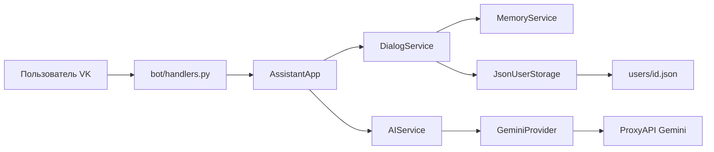

# AI-помощник для ВКонтакте

Бот ведёт несколько независимых диалогов, помнит до 100 последних сообщений в каждом и отвечает через Gemini. Запросы идут в Google GenAI SDK, а адрес API указывает на ProxyAPI.

## Возможности

- Личная переписка с сообществом ВКонтакте
- Нижнее меню и inline-кнопки: новый диалог, список, настройки, режим, помощь
- До 10 диалогов на пользователя: открытие, переименование, удаление
- Пять режимов общения, каждый со своим system prompt
- Память диалога в JSON: роль, текст, время
- Статус «Бот думает…» и индикатор набора текста
- Понятный ответ, если модель или сеть недоступны

## Архитектура



Слой VK не вызывает модель. Обработчик получает `ScreenResponse` и только рисует текст и клавиатуру. Запрос к Gemini собирает `GeminiProvider`.

| Слой | Ответственность |
| --- | --- |
| `bot/` | Long poll, кнопки, набор текста, состояние переименования |
| `services/` | Сценарии, диалоги, память, вызов модели |
| `services/providers/` | Конкретные модели. Сейчас Gemini, место для следующей |
| `storage/` | Один JSON-файл на пользователя и блокировка записи |
| `models/` | Структуры данных, роли, команды кнопок |
| `keyboards/` | JSON клавиатур VKBottle |
| `config/` | Переменные окружения |
| `utils/` | Обрезка текста, контекст, ошибки, логи |

### Классы

- `JsonUserStorage` — чтение и атомарная запись `users/<id>.json`
- `MemoryService` — окно из 100 сообщений и нормализация ролей
- `DialogService` — создание, переключение, имя, режим, удаление, очистка
- `AIService` — единая точка вызова модели
- `GeminiProvider` — Google GenAI SDK и базовый адрес ProxyAPI
- `ChatService` — собирает контекст активного диалога и сохраняет удачный обмен
- `AssistantApp` — тексты экранов
- `Bot` из VKBottle — доставка событий в обработчики

Роли `user` и `assistant` хранятся в JSON. В запрос Gemini роль `assistant` превращается в `model`. System prompt уходит отдельно в `system_instruction`, а не в историю.

## Структура JSON

```json
{
  "schema_version": 1,
  "user_id": 123,
  "active_dialog_id": "a1b2c3d4e5f6",
  "settings": {"language": "ru"},
  "dialogs": [
    {
      "id": "a1b2c3d4e5f6",
      "title": "Основной",
      "role": "assistant",
      "created_at": "2026-10-02T10:00:00Z",
      "updated_at": "2026-10-02T10:05:00Z",
      "messages": [
        {
          "role": "user",
          "content": "Привет",
          "timestamp": "2026-10-02T10:05:00Z"
        },
        {
          "role": "assistant",
          "content": "Здравствуйте.",
          "timestamp": "2026-10-02T10:05:02Z"
        }
      ]
    }
  ]
}
```

При сохранении нового обмена список обрезается до 100 последних сообщений. В запрос попадают эти сообщения плюс новое сообщение пользователя и system prompt текущего режима.

## Режимы

1. Обычный помощник — `assistant`
2. Программист — `programmer`
3. Преподаватель — `teacher`
4. Бизнес-консультант — `business`
5. Дружелюбный собеседник — `friend`

Смена режима меняет system prompt только у активного диалога. История этого диалога не стирается. Новый диалог начинается в режиме обычного помощника.

## Запуск

Нужен Python 3.12 и токен сообщества с доступом к сообщениям. В настройках сообщества включите сообщения и Long Poll API, событие входящих сообщений.

```powershell
python -m venv .venv
.venv\Scripts\activate
pip install -r requirements.txt
copy .env.example .env
python bot.py
```

Заполните `.env`:

```env
VK_TOKEN=
PROXY_API_KEY=
GEMINI_MODEL=gemini-2.5-flash
GEMINI_BASE_URL=https://api.proxyapi.ru
GEMINI_TEMPERATURE=0.7
GEMINI_MAX_OUTPUT_TOKENS=2048
LOG_LEVEL=INFO
```

Если корневого `.env` нет, бот дополнительно читает `.cursor/rules/.env`. Уже заданные переменные окружения важнее файлов. Не коммитьте ключи: оба пути перечислены в `.gitignore`.

Проверка без VK и без модели:

```powershell
.venv\Scripts\python.exe -m unittest discover -s tests -t . -v
```

Пример живого запроса к Gemini, тем же провайдером, что у бота:

```powershell
.venv\Scripts\python.exe examples\gemini_request.py
```

## Запрос к Gemini через ProxyAPI

Официальный SDK сам добавляет путь `/v1beta/models/...`. В `http_options.base_url` передаётся `https://api.proxyapi.ru`, ключ ProxyAPI идёт как API-ключ Google. Короткое имя модели, без префикса вендора: `gemini-2.5-flash`.

```python
from google import genai
from google.genai import types

client = genai.Client(
    api_key="КЛЮЧ_PROXYAPI",
    http_options=types.HttpOptions(base_url="https://api.proxyapi.ru"),
)

response = await client.aio.models.generate_content(
    model="gemini-2.5-flash",
    contents=[
        types.Content(role="user", parts=[types.Part(text="Назови столицу Австралии.")]),
    ],
    config=types.GenerateContentConfig(
        system_instruction="Отвечай по-русски коротко.",
    ),
)
print(response.text)
```

Тот же вызов в проекте: `services/providers/gemini.py`, метод `GeminiProvider.complete`. Временные ошибки HTTP SDK повторяет до трёх попыток. Если ответа так и нет, пользователь видит запасную фразу, а незаконченный обмен в историю не пишется.

## Кнопки

Кнопки стоят под сообщением бота. У каждой есть цвет: без него ВКонтакте клавиатуру не показывает.

- Новый диалог
- Список диалогов
- Настройки
- Сменить режим
- Помощь
- Обычный помощник
- Программист
- Преподаватель
- Бизнес-консультант
- Дружелюбный собеседник

Текущий режим отмечен галочкой. Те же пять названий бот пишет в тексте главного экрана и справки. Список диалогов, карточка и подтверждения — inline-кнопки у сообщения. Удаление и очистка истории спрашивают подтверждение. Переименование ждёт следующее текстовое сообщение; «Отмена» возвращает к диалогу.

Слова «меню», «помощь» и «начать» работают и без кнопок.

## Логи и ошибки

Лог — одна JSON-строка с полями `level`, `message`, `logger`, `time` и при необходимости `context`. Текст переписки и ключи в лог не попадают. Ошибки сервисов имеют вид `{code, message, details}`.

## Масштабирование

Текущее хранилище рассчитано на один процесс бота и каталог `users/`.

- Не запускайте два процесса с одной и той же папкой `users/`: блокировка действует только внутри процесса.
- Новая модель подключается классом с методом `complete` и веткой в `services/providers/__init__.py`. Обработчики VK менять не нужно.
- Имя модели меняется переменной `GEMINI_MODEL`.
- Каталог `users/` стоит включать в резервное копирование.
- При росте числа пользователей файлы можно разложить по подкаталогам, не меняя `DialogService`, если сохранить методы хранилища `get`, `ensure` и `update`.
- Долгие ответы модели уже изолированы от кнопок: нажатие меню не ждёт генерацию другого сообщения, а запись одного пользователя сериализуется блокировкой файла.

## Ограничения

- Только личные сообщения сообщества
- Только текст: вложения бот просит переписать словами
- Не больше 4000 символов во входящем сообщении и части исходящего не длиннее лимита VK
- Не больше 10 диалогов и 100 сообщений в диалоге
- Между запросами к модели у одного пользователя выдерживается пауза в одну секунду
